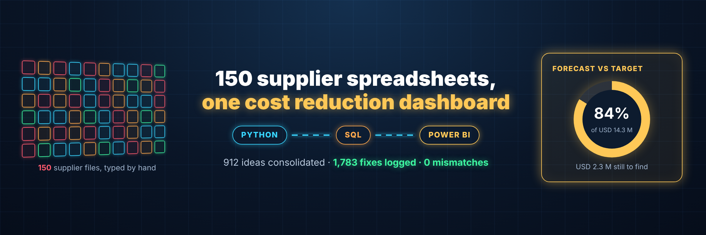
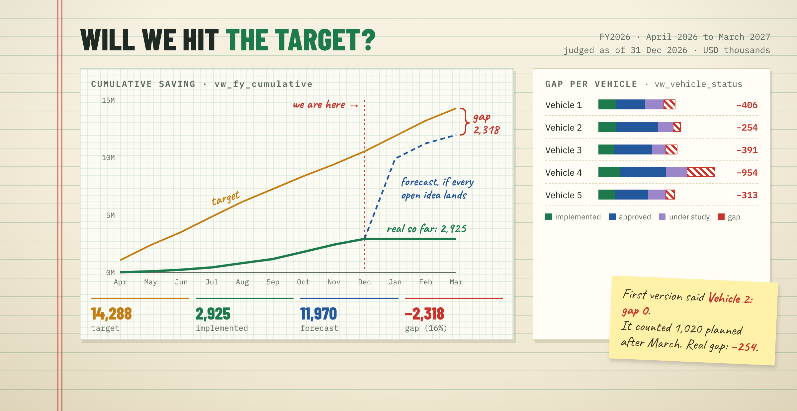
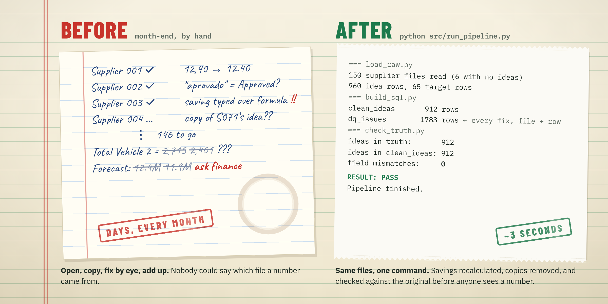
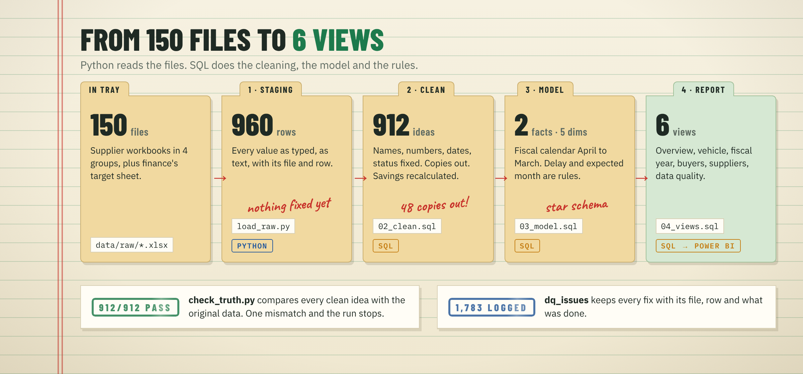
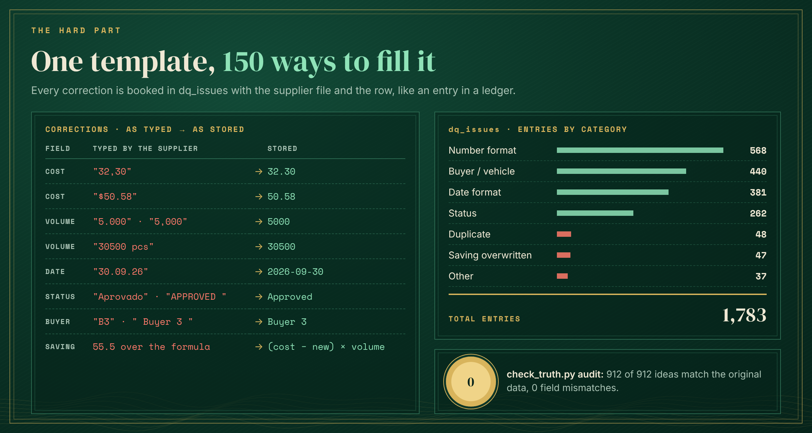

# Cost Reduction Pipeline

A Python and SQL pipeline that consolidates cost reduction ideas from 150 supplier Excel files into one clean model for Power BI, and answers the question the programme lives on: will we hit the savings target this fiscal year?




[](https://github.com/lucasnunesf/pipeline-cost-reduction-powerbi/actions/workflows/tests.yml)

| At a glance | |
|---|---|
| **Result** | 150 supplier files consolidated in one command (about 3 s). 912 ideas recovered with 0 field mismatches. 1,783 fixes, each logged with its file and row. |
| **My role** | I built the cost reduction dashboard while working in procurement at a car manufacturer. This repository is my redesign of the data step behind it: design, Python, SQL, tests. |
| **What's here** | 5 Python scripts, 4 SQL files, a star model, 6 reporting views, 48 automated tests, CI on every commit. |
| **Skills** | Python (openpyxl), SQL (CTEs, window functions, recursive queries), data cleaning, data quality logging, dimensional modelling, fiscal calendars, Power BI, testing (pytest), GitHub Actions |
| **Full case** | [Automotive Cost Reduction Tracking](https://app.notion.com/p/3de917c89c1780c38feccacc9238ab6e) |

The dashboard at work was fed by a base cleaned by hand in Power Query. This version moves that work into a pipeline that can be rerun, traced and tested. It is a case study, not the system used at the company, and all data is synthetic: `src/generate_raw.py` builds the 150 files with the defects found in real hand-filled spreadsheets.

---

## Results



Everything here comes from one run of `python src/run_pipeline.py --generate`, judged as of 31 December 2026 (USD thousands).

| | |
|---|---|
| Target for FY2026 (April 2026 to March 2027) | 14,288 |
| Implemented, real saving | 2,925 (20% of the target) |
| Forecast, if every approved and under-study idea lands on time | 11,970 (84%) |
| Gap still to find | 2,318 (16%) |
| Ideas | 912: 159 implemented, 383 approved, 176 under study, 145 proposed, 49 cancelled |
| Ideas past their planned date | 377, worth 6,772 |

| Before | After |
|---|---|
| Days of opening files one by one, every month | 1 command, about 3 s (9 s when the 150 files are regenerated) |
| Typed-over formulas went into the totals | Every saving recalculated from cost and volume |
| Copied ideas counted twice | 48 copies removed, keeping the owner's file |
| No way to say where a number came from | Every row keeps its source file and row |

---

## The problem



Every supplier sends their cost reduction ideas in an Excel file. They all use the same template ([`templates/supplier_template.xlsx`](templates/supplier_template.xlsx)), but there are 150 of them, filled in by different people and updated all year.

To know how the programme is going, someone had to open the files and add everything up by hand. Questions the team could not answer fast:

- How many ideas do we have, and where are they stuck?
- How much saving is real, and how much is only on paper?
- Are we going to reach the target this fiscal year?
- Which vehicles, buyers and suppliers are delivering?

---

## How it works



| Step | File | What it does | Language | Output |
|---|---|---|---|---|
| 0 | `generate_raw.py` | Creates 150 supplier files and the finance target sheet, defects included, plus a clean copy of every idea | Python | `data/raw/`, `data/truth/` |
| 1 | `load_raw.py` | Reads every file as typed, all text, keeping file and row | Python | 960 staging rows |
| 2 | `02_clean.sql` | Fixes names, numbers, dates and status, removes copies, recalculates savings, logs every fix | SQL | 912 clean ideas, `dq_issues` |
| 3 | `03_model.sql` | Star model with a fiscal calendar (April to March) and the delay rule | SQL | `fact_idea`, `fact_target`, 5 dimensions |
| 4 | `04_views.sql` | One view per report page | SQL | 6 views |
| 5 | `check_truth.py` | Compares every clean idea with the original, field by field, and stops the run on any mismatch | Python | PASS or the rows that differ |

`run_pipeline.py` runs the steps in order and stops at the first one that fails.

### The hard part: one template, 150 ways to fill it



The same value arrives in many shapes: `"12,40"`, `"$12.40"` and `"12.40 USD"` for a cost, `"5.000"` and `"5,000"` for a volume, 25 spellings for 5 statuses. The cleaning lives in SQL, so each rule can be read on its own, and every fix goes into `dq_issues` with the file, the row and what was done. That table also feeds a data quality page, so buyers can see which supplier files need the most attention.

How do we know the cleaning is right? Before adding the defects, the generator saves the clean version of every idea. `check_truth.py` compares the pipeline result with it: 912 of 912 ideas, 0 field mismatches. The 12 ideas sent with no ID and no other copy are kept under a generated key instead of being dropped.

---

## Design decisions

**Staging keeps the data exactly as typed.** Every value lands as text with its file and row. Fixing happens in a separate step, so the original and the cleaned value can always be compared.

**Cleaning is in SQL, not Python.** Each rule is a readable `CASE` or `REPLACE`. Adding a new status spelling is one `INSERT` into `map_status`, not a code change.

**Calculated columns from the source are not trusted.** Suppliers type over formulas, so savings are recalculated from cost and volume. The 47 overwritten ones are logged.

**When an idea is copied into another file, the owner's copy wins.** The supplier code inside the ID (`CR-S071-004` belongs to `S071`) decides. Then the most recent file.

**Delayed is a rule, not a status.** An idea is delayed when its planned date has passed and it is still open. Nobody has to remember to update it.

**One reference date for the whole model.** Delay and forecast are judged against the date the files were collected (`params`), not today, so the numbers do not change by themselves.

**One rule for when a saving is expected.** `fact_idea.expected_month` holds it: the real month for implemented ideas, the planned month for open ones, and the month after the reference date for open ideas already late. Every forecast reads that column.

---

## Try it

```bash
git clone https://github.com/lucasnunesf/pipeline-cost-reduction-powerbi
cd pipeline-cost-reduction-powerbi
pip install -r requirements.txt
python src/run_pipeline.py --generate
```

Real output:

```
=== generate_raw.py
150 supplier files, 912 ideas, targets.xlsx -> data/raw

=== load_raw.py
150 supplier files read (6 with no ideas), 960 idea rows, 65 target rows -> cost_reduction.db

=== build_sql.py
ran 01_mappings.sql
ran 02_clean.sql
ran 03_model.sql
ran 04_views.sql
  clean_ideas        912 rows
  clean_idea_area   1827 rows
  clean_targets       60 rows
  dq_issues         1783 rows

=== check_truth.py
ideas in truth:              912
ideas in clean_ideas:        912
  kept with a generated key: 12
truth ideas not found:       12
unexpected ideas:            0
field mismatches:            0

RESULT: PASS

Pipeline finished.
```

Without `--generate`, it reuses the files already in `data/raw/`. Each step also runs on its own (`python src/load_raw.py`, `python src/build_sql.py`, `python src/check_truth.py`).

---

## Tests

```bash
pytest
```

```
48 passed in 15.96s
```

The same tests run on GitHub Actions on every commit.

| File | Level | What it checks |
|---|---|---|
| `test_cleaning.py` | cleaning rules | each money, volume, date, status and buyer format; areas; recalculated savings; copies; missing IDs |
| `test_rules.py` | business rules | delay, saving month, fiscal calendar, forecast of late ideas, and that two report pages agree |
| `test_pipeline.py` | end to end | generates the 150 files in a scratch folder, runs everything, checks the truth comparison, the data quality log, a rerun, and that a broken rule stops the run |

The cleaning tests build a tiny staging table in memory and run the real `sql/` files over it, so each rule is checked with one row at a time.

### The bug the tests found

Two report pages answer the same question, "how much will we deliver this fiscal year?", and they disagreed. The vehicle page counted every approved and under-study idea. The fiscal-year page left out the ones planned after March 2027. That was 69 ideas worth 1,020.

The vehicle page showed a total gap of 1,303. The fiscal-year page showed 2,318. Vehicle 2 looked fully covered, with a gap of 0. It is 254 short.

`test_vehicle_page_and_fiscal_year_page_expect_the_same_saving` failed on the first version. The fix moved the rule into one column, `fact_idea.expected_month`, which both views now read. Savings expected after the fiscal year are shown apart, in `after_fy_k`.

---

<details>
<summary><b>Data model</b></summary>

```
dim_supplier ─┐                     ┌─ dim_calendar (fiscal year April–March)
dim_buyer ────┼──── fact_idea ──────┤
dim_status ───┘     (one row per    └─ dim_vehicle ──── fact_target
                     idea)                              (vehicle × month)
```

| View | Report page | Question it answers |
|---|---|---|
| `vw_overview` | Overview | How many ideas, where they are, how many are late |
| `vw_vehicle_status` | Status by vehicle | What is real, what is only on paper, and the gap to the target |
| `vw_fy_cumulative` | Fiscal year | Accumulated target vs. implemented saving vs. forecast |
| `vw_buyer_ranking`, `vw_supplier_ranking` | Buyers and suppliers | Who is delivering, who has a lot open or late |
| `vw_dq_by_file` | Data quality | Which supplier files needed the most fixing |

</details>

<details>
<summary><b>Every fix the pipeline logged</b></summary>

| What was found | Rows | What the pipeline did |
|---|---:|---|
| Costs or volumes typed as text ("12,40", "$50.58", "16000 pcs") | 568 | Converted |
| Buyer or vehicle written in a non-standard way | 440 | Mapped to the standard name |
| Dates typed as text, in mixed formats | 381 | Converted, read day first |
| Status written in a non-standard way (25 spellings for 5 statuses) | 262 | Mapped with the `map_status` table |
| Same idea twice, or copied into another supplier's file | 48 | Removed, keeping the owner's copy |
| Saving typed over the formula | 47 | Recalculated from cost and volume |
| Supplier name written differently in the file header | 18 | Name taken from the supplier code |
| Idea with no ID | 13 | 1 recovered from another copy, 12 kept with a generated key |
| Supplier sent the template with no ideas | 6 | Nothing loaded |

</details>

<details>
<summary><b>Project layout</b></summary>

```
templates/supplier_template.xlsx   the template every supplier fills in
src/generate_raw.py                creates the synthetic source files and the truth file
src/load_raw.py                    loads every file into SQLite staging tables, as typed
src/build_sql.py                   runs the SQL files in order
src/check_truth.py                 compares the cleaning with the original clean data
src/run_pipeline.py                runs all the steps in order
sql/01_mappings.sql                lookup tables (status spellings, status order)
sql/02_clean.sql                   cleaning rules and data quality log
sql/03_model.sql                   star model: facts, dimensions, fiscal calendar
sql/04_views.sql                   business rules and reporting views
tests/                             cleaning, rule and end-to-end tests
docs/                              README images
data/                              generated files (not versioned)
```

</details>

<details>
<summary><b>Glossary</b></summary>

- **Cost reduction idea**: a supplier's proposal to make a part cheaper (new material, packaging, route, and so on).
- **Annual saving**: (current cost − new cost) × annual volume, in USD thousands.
- **Approved / Under study / Implemented**: the steps an idea goes through. Only implemented saving is real.
- **Fiscal year**: April to March. FY2026 runs from April 2026 to March 2027.
- **Commodity group**: the family of parts a supplier belongs to.

</details>

---

## Next steps

- Read the supplier files straight from a shared folder or SharePoint instead of a local copy.
- Schedule the monthly run and keep a snapshot of each month, so the forecast can be compared with what really happened.
- Row level security in Power BI, so each buyer sees only their own suppliers.

## How this was built

The problem, the business rules and the design decisions are mine. They come from my work in procurement at Toyota do Brasil. I used an AI coding assistant to write the code faster and reviewed the result.

<!-- Lucas: write here, in your own words, one or two sentences about where you saw this problem happen. -->

## Author

Lucas Fernandes Nunes · [Portfolio](https://lucasnunesf.notion.site) · [GitHub](https://github.com/lucasnunesf)
