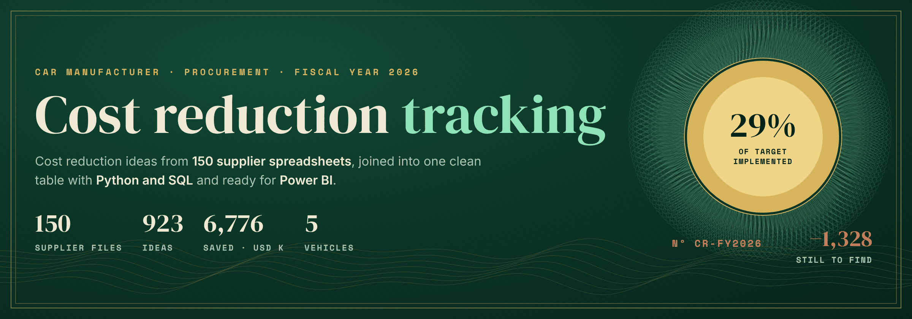
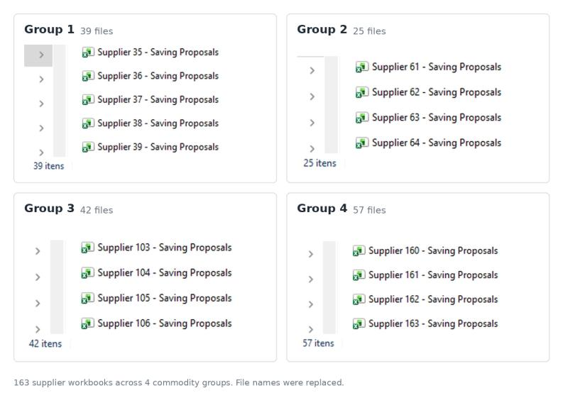
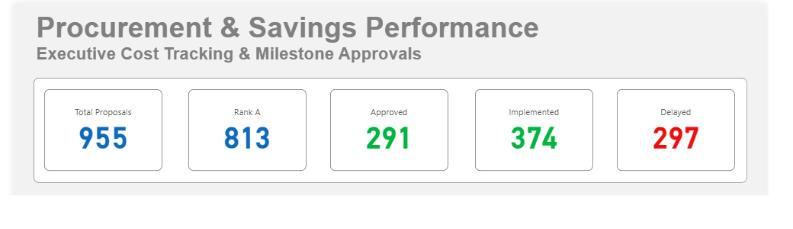
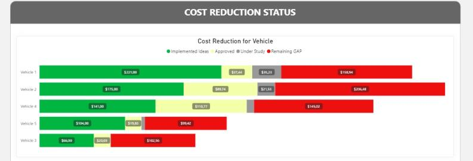
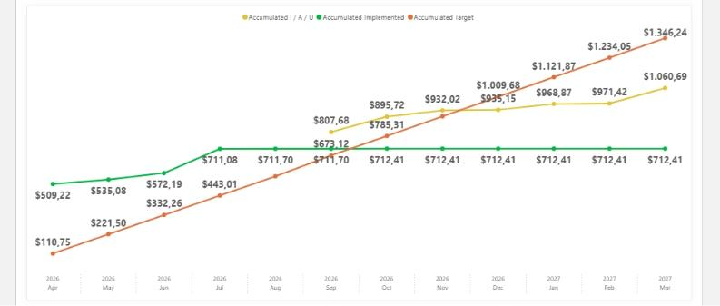
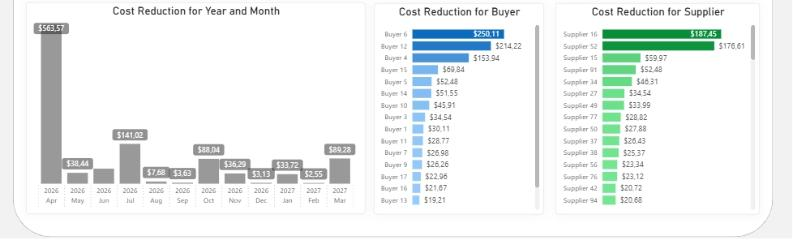

# Cost Reduction Tracking



A Power BI dashboard that brings the cost reduction ideas of 150 suppliers into one place and shows, in the middle of the year, whether the annual savings target will be reached.

| | |
|---|---|
| **Problem** | Every supplier sent its ideas in its own Excel file. Someone opened every file and added everything by hand. It took days, every month. |
| **Where** | Purchasing at a car manufacturer. |
| **Solution** | All files joined into one clean table and a Power BI dashboard with the status of every idea, by vehicle, buyer and supplier. |
| **Result** | Days of monthly work became one refresh, and the gap to the target became visible in the middle of the year, with time to react. |
| **Tools** | Power BI · DAX · Power Query · Excel · Python (pandas) · SQL |

---

## The problem



Every supplier sent its cost reduction ideas in an Excel file, all from the same template. There were more than 150 files, updated during the whole year. To know how the programme was going, someone had to open every file and add everything by hand. It took days, every month, and the team still could not answer quickly:

- How many ideas do we have, and where are they stuck?
- How much saving is real, and how much is only on paper?
- Will we reach the target this fiscal year?

## The dashboard

The dashboard used at work. The numbers, names and vehicles were changed, so no company data is shown. Values in USD thousands.

**Overview.** How many ideas there are and in which status: approved by management (Rank A), approved by finance, already implemented, and late.



**By vehicle.** For each vehicle, how much is implemented, approved, under study and still missing to reach the target.



**Fiscal year.** Saving implemented against the target, added up month by month (April to March). It shows when the implemented line stopped growing.



**Month, buyer and supplier.** Who is delivering, and who has a target with no activity.



## How the data gets there

At work, the files were joined and cleaned by hand in Power Query. This repository does that step automatically, with fake data:

```
150 supplier Excel files  →  Python joins and cleans them  →  SQL views  →  CSV files for Power BI
```

1. **Excel.** `scripts/generate_data.py` creates 150 fake supplier files with the same kind of mistakes as the real ones.
2. **Python.** `scripts/consolidate.py` reads every file with pandas and fixes what was typed by hand:
   - names and status written in different ways (`SUPPLIER 001`, ` implemented `)
   - numbers typed as text (`12,50`) and dates typed as text (`05/09/2026`)
   - blank rows, and the same idea copied into two files
3. **SQL.** The clean table goes into a SQLite database, and `sql/views.sql` has one view per dashboard page: status, by vehicle, fiscal year (running total with `SUM() OVER`), by buyer and by supplier.
4. **Power BI.** Each view is saved as a CSV in `output/`, ready for Power BI.

## Results (fake data)

| | |
|---|---|
| Rows read from 150 files | 975 |
| Blank rows removed | 37 |
| Ideas copied into two files, kept once | 15 |
| Ideas after cleaning | 923 |
| Target for the fiscal year | USD 23,252k |
| Saving already implemented | USD 6,776k (29% of the target) |
| If every approved and under-study idea lands | 94% of the target, USD 1,328k still to find |

## Files

| Folder | What is in it |
|---|---|
| `data/` | The 150 fake supplier files and the target file |
| `scripts/` | `generate_data.py` (creates the files) and `consolidate.py` (cleans and loads SQL) |
| `sql/` | `views.sql`, the five views used by Power BI |
| `output/` | The CSV files Power BI reads |
| `docs/` | Images |

To run it:

```bash
pip install -r requirements.txt
python scripts/consolidate.py
```

## Background

Based on my work in purchasing at Toyota do Brasil. The dashboard images are from the real report with all numbers and names changed; the data in this repository is synthetic.

---

Lucas Fernandes Nunes · [Portfolio](https://lucasnunesf.notion.site/Lucas-Nunes-Data-BI-Analyst-3de917c89c178092885cf639b619767b) · [GitHub](https://github.com/lucasnunesf)
